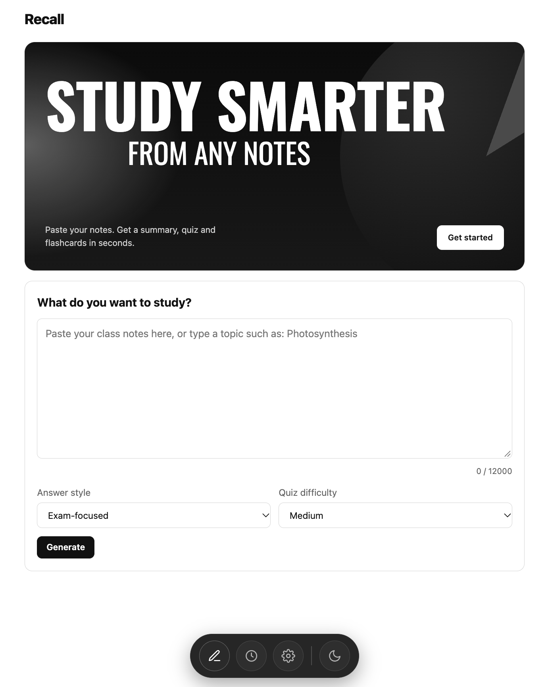
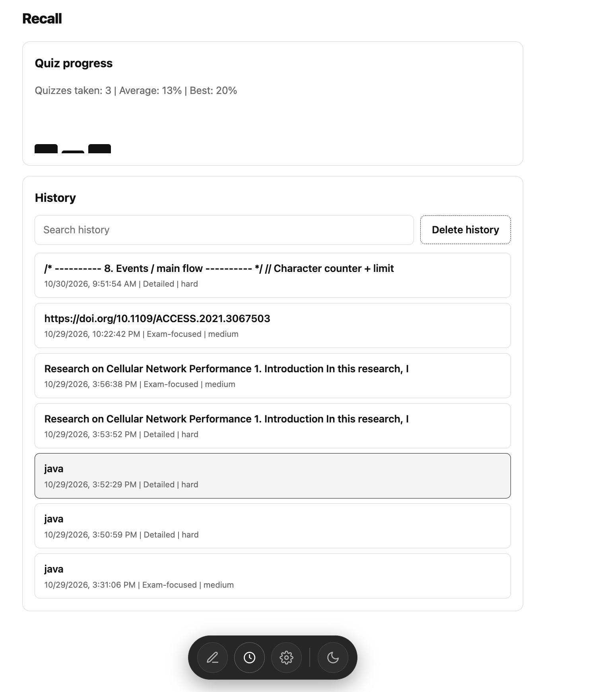

# Recall – AI Study Assistant

Recall is an AI-powered study assistant that transforms your notes into summaries, quizzes, and flashcards using Google Gemini AI.

## Features
- AI-generated summaries
- Interactive quizzes
- Flashcard generation
- Customizable answer styles and quiz difficulty
- Study history
- Dark and light mode

## Tech Stack
- HTML
- CSS
- JavaScript
- Google Gemini API

## Run Locally
1. Clone the repository.
2. Open `index.html` in your browser.
3. Add your Gemini API key in Settings.

